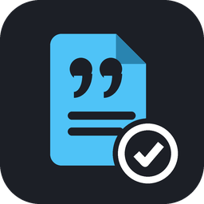

<p align="center">
  
</p>

<h1 align="center">Citewatch</h1>

<p align="center">
  <strong>Make every release citable, without surprises.</strong><br>
  Checks <code>.zenodo.json</code> and <code>CITATION.cff</code> as you type, keeps versions in step, shows your DOI, and warns when Zenodo is not switched on before you release.
</p>

<p align="center">
  <a href="https://github.com/kabartay/citewatch/actions/workflows/ci.yml"></a>
  <a href="https://doi.org/10.5281/zenodo.23270119"></a>
  <a href="https://github.com/kabartay/citewatch/releases/latest"></a>
  <a href="LICENSE"></a>
  <a href="package.json"></a>
  <a href="tsconfig.json"></a>
  <a href="package.json"></a>
  <a href="#caveats"></a>
</p>

## At a glance

```text
$(book) zenodo.23269419 · 0.1.3       your concept DOI and the newest archived version
$(warning) zenodo.23269419 · 0.1.3    amber: Zenodo is not switched on for this repository
$(book) No DOI yet                    citation files present, nothing archived yet
```

Hover for the DOIs, what is archived and what your files say. Click to copy the DOI or a badge,
open the record, or set the version everywhere.

## Why

Zenodo's GitHub integration turns each release into an archived, citable version with its own
DOI. When something is wrong it fails quietly: the release is published on GitHub, and the DOI
never appears. The usual causes are small:

- the repository was never switched on in Zenodo, so no webhook fired;
- `.zenodo.json` has a licence Zenodo does not know, such as `Apache-2.0` instead of
  `apache-2.0`, or misses a required field;
- `package.json` says one version, `CITATION.cff` another, and the archive records the wrong one;
- an ORCID with a typo, which fails its check digit.

Citewatch catches each of them in the editor, before the tag.

## What it checks

As you type, in `.zenodo.json` and `CITATION.cff`, with a squiggle on the line:

| Check | Severity |
| --- | --- |
| `.zenodo.json` is valid JSON and has all six fields Zenodo requires | error |
| Licence is in Zenodo's live licence vocabulary, and lowercase | error |
| `upload_type` and `access_right` are values Zenodo accepts | error |
| Every creator has a name, written `Family, Given` | error / warning |
| ORCIDs are well formed and pass their ISO 7064 check digit | error |
| `CITATION.cff` has `cff-version`, `title`, `message` and `authors` | error |
| `date-released` is a quoted `YYYY-MM-DD`, not in the future | error / warning |
| DOIs look like DOIs; ORCIDs in `CITATION.cff` are URLs | error / warning |
| Versions are written `1.2.3`, not `v1.2.3` | warning |
| `package.json`, `pyproject.toml`, `CITATION.cff` and `.zenodo.json` state the same version | warning |

Both files also get schema validation and completion: `.zenodo.json` from Citewatch's schema,
`CITATION.cff` from the official Citation File Format 1.2.0 schema (YAML validation needs the
[YAML extension](https://marketplace.visualstudio.com/items?itemName=redhat.vscode-yaml)).

## Where the DOI comes from

In order: the DOI in `CITATION.cff`'s `identifiers`, then a Zenodo DOI badge in `README.md`,
then a Zenodo search for a record with exactly your title **and** one of your creators, so
another project with the same name is never mistaken for yours. Versions come from Zenodo's
public API, newest first.

## Is Zenodo switched on?

Zenodo's switch installs a webhook on the repository. Citewatch reads the repository's webhooks
through the GitHub account you are signed in to in VS Code (it never asks on its own; choose
**Sign in to GitHub** from the status bar menu), which needs admin access to the repository. Off
means a release now would get no DOI, and the status bar turns amber.

## Install

**Requirements:** VS Code 1.85 or newer.

1. In VS Code, open Extensions, search **Citewatch**, and click **Install**.
2. Or download the `.vsix` from [Releases](https://github.com/kabartay/citewatch/releases) and
   use **Extensions → ··· → Install from VSIX…**.

Open a folder with a `CITATION.cff` or `.zenodo.json`; the status bar item appears.

## Commands

| Command | Does |
| --- | --- |
| **Citewatch: Copy Concept DOI** | The DOI that always resolves to the newest version: cite this one |
| **Citewatch: Copy Latest Version DOI** | The DOI of the newest archived version |
| **Citewatch: Copy DOI Badge (Markdown)** | A shields.io badge, which `vsce` accepts in an extension's README; Zenodo's own SVG badge it refuses |
| **Citewatch: Set Version Everywhere…** | Writes one version into every file above, changing only the version line |
| **Citewatch: Refresh** | Re-reads the files and Zenodo now |
| **Citewatch: Show Log** | Opens the log |

## Settings

| Setting | Default | Meaning |
| --- | --- | --- |
| `citewatch.checkLicenceOnline` | `true` | Check the licence against Zenodo's live vocabulary; off, only offline checks run |
| `citewatch.checkZenodoSwitch` | `true` | Check Zenodo's webhook through your GitHub sign-in |
| `citewatch.showStatusBar` | `true` | Show the DOI and archived version in the status bar |

## Privacy

Zenodo is asked, without any token, for public data only: whether a licence id exists, a
record's versions, and a title search. GitHub is asked, with your VS Code GitHub session, for
one thing: the repository's webhooks. Nothing is sent anywhere else, there is no telemetry, and
Citewatch never creates a release, a record or a webhook. It edits a file only when you run
**Set Version Everywhere**.

## Caveats

- **Unofficial.** Not affiliated with Zenodo, CERN or GitHub. It uses Zenodo's and GitHub's
  public REST APIs, which may change.
- **GitHub and Zenodo's GitHub integration only.** GitLab and manual Zenodo uploads are not
  covered.
- Reading webhooks needs admin access; without it, the switch shows as unknown, never as off.

## Documentation

- [Architecture](docs/ARCHITECTURE.md): layers, how a summary is built, the checks
- [Development](docs/DEVELOPMENT.md): building, testing, releasing
- [Troubleshooting](docs/TROUBLESHOOTING.md): when the status bar or a check is wrong
- [Security](docs/SECURITY.md): exactly what is read and sent

## License

[MIT](LICENSE). The bundled Citation File Format schema is CC-BY-4.0; see [NOTICE](NOTICE).
