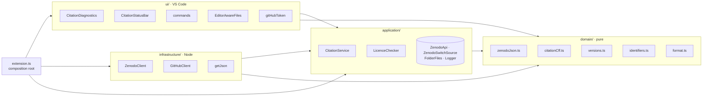

# Architecture

Four layers, the same as Tokenwatch's and Jobwatch's, so that every check runs without VS Code.

| Layer | Holds | May import |
| --- | --- | --- |
| `domain/` | The checks, identifiers (ORCID, DOI), versions, creators, repository and display text | nothing outside `domain/` |
| `application/` | The folder summary with its cache (`CitationService`), the licence cache, the ports | `domain/` |
| `infrastructure/` | HTTPS, the Zenodo and GitHub clients | `application/`, `domain/` |
| `ui/` | Diagnostics, status bar, commands, files, GitHub sign-in, settings | `application/`, `domain/` |

`eslint.config.ts` enforces the table: the lint fails when a layer imports what it may not.

## The checks

`checkZenodoJson` and `checkCitationCff` take a file's text and return problems with a line,
severity and code; `versionMismatches` compares the versions every file states against the first
of `package.json`, `pyproject.toml`, `CITATION.cff`, `.zenodo.json`. `CitationDiagnostics`
reruns them 400 ms after an edit, reading other files from open editors first, so a version
fixed in one unsaved file clears the warning in the others. The only check that goes online is
the licence, cached per id; when Zenodo cannot answer, nothing is reported.

## A summary

1. `CitationStatusBar` asks `CitationService.summary` for the active folder; a summary is
   cached for ten minutes, since Zenodo allows about 30 requests a minute.
2. The repository comes from `.git/config`'s `origin`; the concept DOI from `CITATION.cff`, else
   a README badge, else a Zenodo title search that also requires a shared creator family name.
3. Versions come from `/api/records?q=conceptrecid:…&all_versions=true`, 25 at most (Zenodo's
   anonymous page limit), newest first.
4. The switch comes from `/repos/{repo}/hooks`: on if an active hook to `https://zenodo.org/`
   listens for releases. Any failure, including no admin access, is unknown, never off.

## Setting the version

`withVersion` replaces only the version line of each file, keeping its formatting, and the
command applies the change as a workspace edit and saves it.
